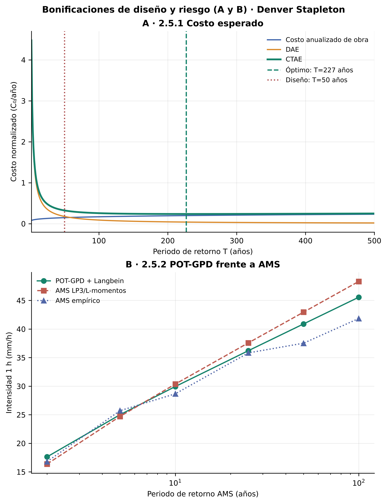
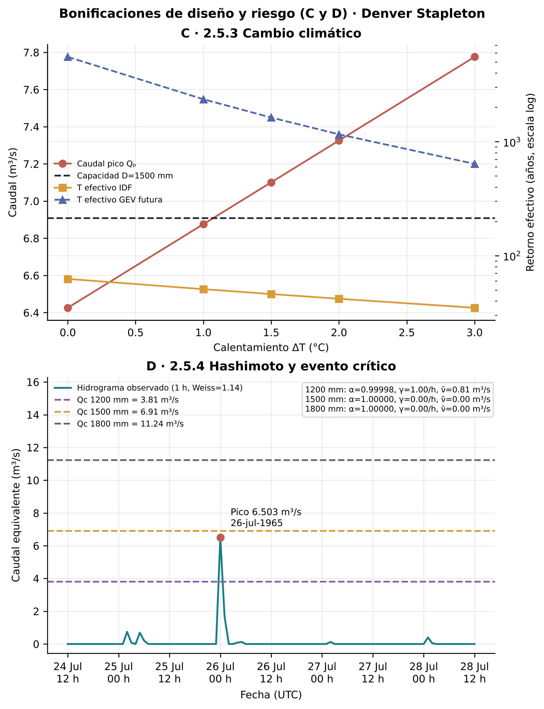

# Informe hidrológico · Punto 2

## 2.5 · Bonificaciones de Diseño y Riesgo

Los cálculos complementarios se procesaron con los archivos locales de la estación NOAA GHCNh Denver Stapleton (`USW00023062`). Los costos del apartado 2.5.1 se expresan en múltiplos normalizados de `C0`, ya que no se proporcionó un costo monetario base.

### 2.5.1 · Costo esperado de protección

Se calcula la intensidad con la IDF y el caudal racional `Q(T)=C·i(tc,T)·A/3.6`. El costo de obra es `Cobra=C0·(Qd/Q2)^0.6`, anualizado mediante el factor de recuperación de capital `FRC=r(1+r)^n/((1+r)^n−1)`. El daño para `Q>Qd` es `Dmax·[1−exp(−(Q−Qd)/(0.5Qd))]`; su integral en probabilidad anual de excedencia entrega el DAE, y `CTAE=Canual+DAE`.

Con `n=25`, `r=6%` y `Dmax=20C0`, el mínimo es **Tóptimo=227 años**. La integración numérica emplea 5,000 puntos medios entre 0 y `1/Td`.

| T_d_y | Canual_C0_per_year | DAE_C0_per_year | CTAE_C0_per_year |
|---|---|---|---|
| 2 | 0.07823 | 4.398 | 4.477 |
| 50 | 0.147 | 0.1759 | 0.3229 |
| 227 | 0.1977 | 0.03875 | 0.2365 |
| 500 | 0.2308 | 0.01759 | 0.2484 |

Sensibilidad factorial `Dmax/C0 ∈ {10,20,40}` y `r ∈ {3%,6%,10%}`:

| Dmax_multiplier_C0 | rate_sensitivity | T_d_y | CTAE_C0_per_year |
|---|---|---|---|
| 10 | 0.03 | 165 | 0.163 |
| 10 | 0.06 | 127 | 0.2111 |
| 10 | 0.1 | 96 | 0.2811 |
| 20 | 0.03 | 294 | 0.1826 |
| 20 | 0.06 | 227 | 0.2365 |
| 20 | 0.1 | 171 | 0.3149 |
| 40 | 0.03 | 500 | 0.2046 |
| 40 | 0.06 | 405 | 0.2649 |
| 40 | 0.1 | 304 | 0.3527 |

### 2.5.2 · Frecuencia POT/GPD y Langbein

Los máximos de tormenta se independizaron con al menos 6 horas secas. Se aplicó Weiss=1.14 a las intensidades horarias observadas, se escogió un umbral que produce aproximadamente 2 excedencias anuales y se ajustó una Pareto Generalizada (`scipy.stats.genpareto`, `c=+ξ`) a los excesos. La conversión a retorno AMS es `T_AMS=1/[1−exp(−1/T_E)]`.

| return_period_AMS_y | return_period_event_T_E_y | POT_quantile_mm_h | AMS_LP3_LMOM_quantile_mm_h | AMS_empirical_quantile_mm_h |
|---|---|---|---|---|
| 2 | 1.443 | 17.63 | 16.37 | 16.8 |
| 5 | 4.481 | 25.01 | 24.71 | 25.71 |
| 10 | 9.491 | 29.94 | 30.37 | 28.66 |
| 25 | 24.5 | 36.21 | 37.57 | 35.82 |
| 50 | 49.5 | 40.89 | 42.96 | 37.52 |
| 100 | 99.5 | 45.57 | 48.33 | 41.85 |

El umbral aplicado fue 9.40 mm/h antes de Weiss (10.72 mm/h después); se obtuvieron 91 eventos en 45 años válidos (`λ=2.022/año`). POT y AMS son métodos distintos: sus diferencias reflejan la tasa de eventos, el umbral y la extrapolación GPD.

### 2.5.3 · Cambio climático y no estacionariedad

Se aplicó el escalamiento de intensidad `1+0.07·ΔT` (Westra et al., 2014). La GEV no estacionaria usa `μ(t)=μ0+μ1t`, se evalúa en `t_final+25` y calcula la supervivencia sobre el mismo umbral crítico de la obra `i*=3.6Qc/(CA)=48.93 mm/h`. La fila base `ΔT=0` recupera `i(60 min,50)=45.51 mm/h`, `Q50=6.426 m³/s` y `Dcom=1500 mm`, los mismos del Problema A.

| delta_temperature_C | i_tc_future_mmh | Qp_future_m3s | D_commercial_mm | T_effective_IDF_y | risk_25y_IDF | GEV_future_evaluation_year_t_final_plus_25 | T_effective_GEV_nonstationary_y | risk_25y_GEV |
|---|---|---|---|---|---|---|---|---|
| 0 | 45.51 | 6.426 | 1500 | 62.42 | 0.3322 | 2019 | 5549 | 0.004496 |
| 1 | 48.7 | 6.876 | 1500 | 50.74 | 0.392 | 2019 | 2358 | 0.01055 |
| 1.5 | 50.29 | 7.101 | 1800 | 45.98 | 0.4229 | 2019 | 1628 | 0.01524 |
| 2 | 51.88 | 7.326 | 1800 | 41.79 | 0.4542 | 2019 | 1160 | 0.02132 |
| 3 | 55.07 | 7.776 | 1800 | 34.82 | 0.5173 | 2019 | 638.2 | 0.03844 |

**Discusión:** la IDF determinística y la GEV futura no son intercambiables; la segunda incorpora una tendencia extrapolada y puede ser muy sensible al periodo de ajuste. El 7%/°C es un escenario de sensibilidad, no un pronóstico local calibrado.

### 2.5.4 · Confiabilidad, resiliencia y vulnerabilidad de Hashimoto

Se estimó el caudal horario equivalente `Q(t)=C·A·i(t)/3.6`, con corrección Weiss=1.14. La confiabilidad `α` es la fracción temporal sin excedencia; la resiliencia `γ` es la tasa de transición de falla a cumplimiento, y `1/γ` aproxima la duración media de falla bajo esa definición. La vulnerabilidad `ν` se resume con el exceso medio y máximo sobre la capacidad.

| diameter_mm | Qc_m3s | valid_hours_evaluated | failed_hours | reliability_alpha | resilience_gamma_per_hour | mean_failure_duration_1_over_gamma_hours | vulnerability_mean_excess_m3s | vulnerability_max_excess_m3s | historical_exceedance_events |
|---|---|---|---|---|---|---|---|---|---|
| 1200 | 3.811 | 3.96e+05 | 8 | 1 | 1 | 1 | 0.8131 | 2.692 | 8 |
| 1500 | 6.909 | 3.96e+05 | 0 | 1 |  | inf | 0 | 0 | 0 |
| 1800 | 11.24 | 3.96e+05 | 0 | 1 |  | inf | 0 | 0 | 0 |

Eventos de excedencia históricos guardados:

| diameter_mm | start_utc | end_utc | duration_hours | peak_Q_m3s | peak_excess_m3s |
|---|---|---|---|---|---|
| 1200 | 1951-08-03T09:00:00+00:00 | 1951-08-03T09:00:00+00:00 | 1 | 5.022 | 1.212 |
| 1200 | 1953-07-10T01:00:00+00:00 | 1953-07-10T01:00:00+00:00 | 1 | 3.879 | 0.06867 |
| 1200 | 1954-07-15T01:00:00+00:00 | 1954-07-15T01:00:00+00:00 | 1 | 3.879 | 0.06867 |
| 1200 | 1956-08-03T00:00:00+00:00 | 1956-08-03T00:00:00+00:00 | 1 | 5.119 | 1.308 |
| 1200 | 1958-07-18T22:00:00+00:00 | 1958-07-18T22:00:00+00:00 | 1 | 3.96 | 0.1492 |
| 1200 | 1961-05-21T05:00:00+00:00 | 1961-05-21T05:00:00+00:00 | 1 | 4.089 | 0.2779 |
| 1200 | 1965-07-26T00:00:00+00:00 | 1965-07-26T00:00:00+00:00 | 1 | 6.503 | 2.692 |
| 1200 | 1967-06-20T23:00:00+00:00 | 1967-06-20T23:00:00+00:00 | 1 | 4.539 | 0.7286 |

Con la tubería de 1500 mm (Qc=6.909 m³/s) ningún evento horario del registro supera la capacidad; las 8 superaciones guardadas son de diámetros menores. La evaluación se limita a resolución horaria y al modelo racional equivalente; no sustituye un tránsito hidráulico.

